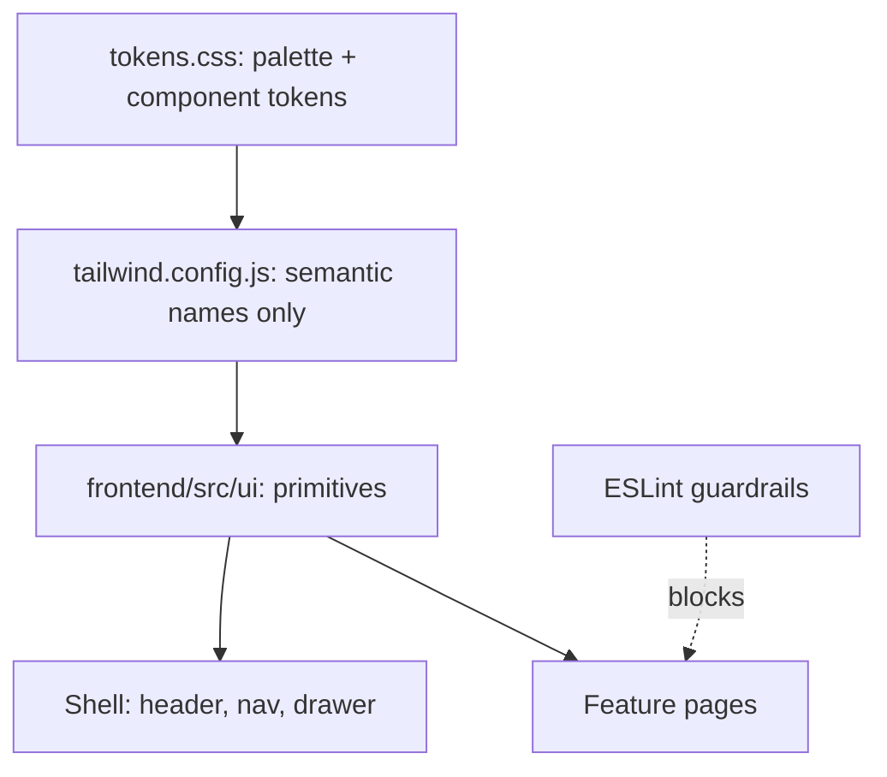

# Instrument design system (no component frameworks)

## Why it drifted

- Three parallel token systems: shadcn HSL (`--primary`, `--card`...), RGB tokens (`--surface`...), and `dark-*` tokens, all exposed in [frontend/tailwind.config.js](frontend/tailwind.config.js).
- Two `Input` implementations: [frontend/src/components/Input.tsx](frontend/src/components/Input.tsx) and [frontend/src/shared/components/ui/Input.tsx](frontend/src/shared/components/ui/Input.tsx), plus `InputNumber`.
- Hand-styled surfaces in [GasForm.tsx](frontend/src/features/gas/components/GasForm.tsx), [GasReadingCard.tsx](frontend/src/features/gas/components/GasReadingCard.tsx), and [HomeProfilePage.tsx](frontend/src/features/home-profile/pages/HomeProfilePage.tsx) (`rounded-xl`, `shadow-2xl`, `dark:` overrides).
- `corePlugins.preflight: false`, so native `button`/`input` browser styling leaks through (bevels and borders that read as "3D").

## Decisions (confirmed)

- Remove `@radix-ui/*`, `class-variance-authority`, `tailwindcss-animate`, and every shadcn file. Accessibility is ours: native `<dialog>`, native `<select>`, `role="switch"` button, plus focus-trap and Escape hooks.
- Keep: Tailwind, `lucide-react` (icons only), `clsx` + `tailwind-merge` inside a single `cn` util.
- Visual direction: **instrument panel**. Dark is the default; light is a "daylight" mapping of the same tokens.

## Visual language (instrument panel)

- Palette (hex only in tokens): canvas `#05070b`, panel `#0b0f16`, raised `#111723`, line `#1f2733`, line-strong `#2c3746`, ink `#e8edf4`, ink-muted `#9aa6b6`, ink-dim `#6b7788`, signal `#ff6b3d`, ok `#22c55e`, warn `#f5a524`, fault `#ef4444`, info `#38bdf8`.
- Geometry: 1px hairlines, radius 2px for controls and 4px for panels, **no shadows anywhere**.
- Signature details: panel header strip (uppercase mono label + status LED), corner tick marks drawn with Tailwind `before:`/`after:` utilities, faint dot-grid canvas, mono `tabular-nums` readouts.
- Signal orange is used only for primary action, focus, and live state. Primary button text is dark ink on signal (about 7:1 contrast instead of 2.9:1 with white).
- Motion: color transitions only, 120ms; honour `prefers-reduced-motion`.

## Token contract (every component has tokens)

In [frontend/src/design/tokens.css](frontend/src/design/tokens.css), one layer only:

- Palette: `--canvas`, `--panel`, `--raised`, `--line`, `--line-strong`, `--ink`, `--ink-muted`, `--ink-dim`, `--signal`, `--ok`, `--warn`, `--fault`, `--info`.
- Button: `--btn-{primary|secondary|ghost|danger}-{bg|bg-hover|fg|border}`.
- Input: `--input-bg`, `--input-border`, `--input-border-hover`, `--input-border-focus`, `--input-fg`, `--input-placeholder`, `--input-invalid`.
- Panel: `--panel-bg`, `--panel-border`, `--panel-header-bg`, `--hero-bg`, `--hero-border`.
- Sizing: `--control-h-sm` 32px, `--control-h-md` 36px, `--control-h-lg` 40px, `--radius-control` 2px, `--radius-panel` 4px.

[frontend/tailwind.config.js](frontend/tailwind.config.js) is rewritten to expose only these names (`bg-canvas`, `border-line`, `text-ink-muted`, `bg-btn-primary`, `h-control-md`...). All shadcn and `dark-*` names are deleted. Turn preflight back on so native styling cannot leak.

## Primitives — `frontend/src/ui/` (kebab-case, at most 200 lines each)

- Actions: `button.tsx` (variants `primary | secondary | ghost | danger`, sizes `sm | md | lg`, `isLoading`), `icon-button.tsx` (same tokens, square, `aria-label` required).
- Fields: `field.tsx` (label + control + hint + error, wires `aria-describedby`/`aria-invalid`), `text-input.tsx`, `number-input.tsx`, `textarea.tsx`, `select.tsx` (native, styled), `checkbox.tsx`, `switch.tsx`.
- Surfaces: `panel.tsx` (+ `PanelHeader`, `PanelBody`, `PanelFooter`), `hero-panel.tsx` (the only allowed variant), `data-table.tsx`.
- Display: `readout.tsx` (label + mono value + unit), `gauge-bar.tsx` (progress, normal and overtime states), `badge.tsx`, `banner.tsx`, `skeleton.tsx`, `led.tsx`.
- Overlays: `modal.tsx` and `drawer.tsx` on native `<dialog>`, with hooks `use-focus-trap.ts` and `use-escape-key.ts`.
- Layout: `page-header.tsx`, `stack.tsx` (fixed rhythm: page 24px, section 16px, field 12px).
- Variant maps are plain `Record<Variant, string>` objects; no cva.

## Migration (every page, nothing left behind)

- Shell: [MainLayout.tsx](frontend/src/components/MainLayout.tsx), `shell-nav-list`, and `shell-nav-drawer` rebuilt on `ui/` (the drawer becomes `ui/drawer`).
- Shared app components (`temp-dialog`, `confirm-dialog`, `query-state`, `status-banner`, `stat-card`) rebuilt on `ui/`.
- Pages: Login, Dashboard (hero = `hero-panel`, progress = `gauge-bar`), Boiler, Heating, GasReadings (+ `GasForm` and `GasReadingCard` rewritten), GasAnalytics, Reports, Notifications, Profile, HomeProfile.
- Delete `frontend/src/shared/components/ui/*`, `components/Input.tsx`, `components/InputNumber.tsx`, `brand-mark` (replaced by a `ui/` logo mark), and all `dark:` overrides in features.

## Guardrails (so it cannot drift again)

- ESLint `no-restricted-imports`: `@radix-ui/*`, `class-variance-authority`, and the old `shared/components/ui` and `components/Input*` paths.
- ESLint `no-restricted-syntax` in `src/features/**`: raw `<button>`, `<input>`, `<select>`, `<textarea>`, and `className` containing `shadow-`, `rounded-xl`, or `dark:`.
- Dev-only `/design` route: a gallery that renders every primitive in every state, used for visual verification.
- Matrix: `.cursor/docs/matrices/design-system/MATRIX.md` (component, variants, tokens, states) + `CHANGELOG.md`.
- Tests: rewrite the primitive tests (keyboard, focus trap, Escape, axe), and keep existing feature tests green.

## Delivery

The plan has more than 3 phases, so create `.cursor/plans/instrument-design-system/` (`00_overview.md`, `01_phase-*.md`, `CHECKLIST.md`, `CHANGELOG.md`, `HANDOFF.md`). Each phase is one commit on `main`, then push and wait for green CI; stop between phases for review (same Approach A as before).

## Out of scope

Backend, Prisma, mobile, data logic, and copy changes beyond what new components need.
