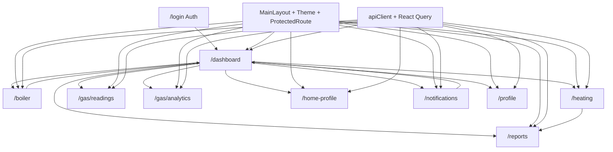

# 01 — Mapa modula

Linije su neprazne (`Measure-Object -Line`), 2026-11-06. Testovi nisu uračunati u LOC modula.

Rute su iz `frontend/src/App.tsx`. Sve osim `/login` i `/` idu kroz `ProtectedRoute` + `MainLayout`. `/` radi `Navigate` na `/dashboard`. Nema provjere uloge.

## Moduli

| Modul | Ruta | Svrha | Ključni fajlovi | LOC | API (web) | Prisma (preko API) | Ovisi o |
|---|---|---|---|---:|---|---|---|
| Shell | sve zaštićene | Navigacija, tema, odjava | `components/MainLayout.tsx` 239, `ProtectedRoute.tsx` 38, `App.tsx` 181, `context/ThemeContext.tsx` 73, `shared/components/SkipLink.tsx` 17, `Announcer.tsx` 22 | 570 | nema | — | auth |
| Auth | `/login` | Prijava | `features/auth/pages/LoginPage.tsx` 71, `AuthContext.tsx` 123, `hooks/useAuth.ts` 9 | 203 | `POST /api/auth/login`, refresh/logout, `detectAuthMode` | `User`, `RefreshToken` | `services/api.ts` |
| Dashboard | `/dashboard` | KPI, grijanje, notifikacije, temperatura kotla | `features/dashboard/pages/DashboardPage.tsx` 1128, `hooks/useDashboardHeatingRange.ts` 40 | 1168 | `getDashboard`, `getDashboardHealth`, heating events/summary/status (poll 60s, limit 500), home profile, weather, notifications, `setBoilerCurrentTemp` | User, HomeProfile, HeatingEvent, Recommendation, Notification, BoilerHistory, Weather* | shell, notifications keys, boiler limits |
| Boiler | `/boiler` | Historija i postavljanje temperature polaza | `features/boiler/pages/BoilerPage.tsx` 233 | 233 | `getBoilerEvents`, `setBoilerCurrentTemp` | `BoilerHistory`, `User.currentBoilerFlowTemp` | `constants/boilerLimits.ts` |
| Heating | `/heating` | Lista događaja grijanja | `features/heating/pages/HeatingPage.tsx` 115, `components/RecommendationBreakdown.tsx` 115 | 230 | `getHeatingEvents` | `HeatingEvent`, `Recommendation` | reports koristi breakdown |
| Gas readings | `/gas/readings` | Unos, brisanje, slike, fakture | `GasReadingsPage.tsx` 284, `GasForm.tsx` 302, `GasReadingCard.tsx` 178, `useGasQueries.ts` 46 | 810 | readings CRUD, meter image, invoice | `GasReading` | i18n, `apiClient` |
| Gas analytics | `/gas/analytics` | Potrošnja u periodu | `GasAnalyticsPage.tsx` 271 + isti hook | 271 | `getGasAnalysis`, `getGasReadings` | `GasReading` | `StatCard`, gas hook |
| Reports | `/reports` | Sačuvane preporuke | `features/reports/pages/ReportsPage.tsx` 110 | 110 | `getReports` → `GET /api/recommendations` | `Recommendation` | `RecommendationBreakdown` |
| Home profile | `/home-profile` | Parametri kuće | `HomeProfilePage.tsx` 486, `api/homeProfileApi.ts` 33, `lib/schemas.ts` 70, `types/index.ts` 64, `index.ts` 19 | 672 | GET/POST `/api/home-profile`, PATCH `/:id` | `HomeProfile` | antd forme, enumi |
| Notifications | `/notifications` | Lista, pročitano, sve pročitano | `NotificationsPage.tsx` 226, `hooks/useNotifications.ts` 46 | 272 | GET notifications, POST read, mark-all-read, preferences | `Notification`, `NotificationPreference` | isti query ključevi kao dashboard |
| Profile | `/profile` | Ime, lokacija, cijena plina | `features/profile/pages/ProfilePage.tsx` 189 | 189 | GET/PUT `/api/user` | `User`, `GasPriceHistory` | antd |

Zajednički sloj koji nije stranica: `services/api.ts` (505), `locales/config.ts` (550), `lib/queryClient.ts` (24), `lib/queryKeys.ts` (25), generisani `types/api.d.ts` (3465).

Redis ključeva po modulu nema. Vidi `00-project-overview.md`.

## Dijagram

## Stanje stabla koje utiče na redoslijed

Ovo su činjenice iz čitanja, ne Faza 2.

1. `MainLayout.tsx` spaja dva layouta. Linija 21 destructura `Layout` koji nije importovan. Linije 109–166 koriste antd `Layout`/`Sider`/`Menu` i zatvaraju `</Tooltip>`, `
`, `</header>`. Linije 167–248 nastavljaju drugi, Tailwind layout. `tsc` javlja TS17002 na linijama 159, 165, 166, 248.
2. `DashboardPage.tsx` oko 912–979 miješa `
` drawer i antd `<Drawer>`/`<Modal>`, pa parser staje (TS17002/TS17008 od linije 937).
3. `LoginPage.tsx:5` importuje `../components/index` (to je `features/auth/components`, fajl ne postoji u stablu).
4. `GasReadingsPage.tsx:9` importuje `../components/index` (`features/gas/components/index.ts` ne postoji). `GasForm.tsx` i `GasReadingCard.tsx` importuju `./Button` i `./Input` u istom folderu; ti fajlovi su u `frontend/src/components/`.
5. `components/index.ts` re-eksportuje `./GasReadingCard` i `./GasForm`, a tih fajlova nema u `frontend/src/components/`.
6. `ReportsPage.tsx:11` zove `useTranslation()` bez importa.

`tsc` u ovoj sesiji ispisuje samo parse greške u tačkama 1 i 2. Semantičke greške iz tačaka 3–6 nisu se pojavile u tom ispisu. Nedostajući fajlovi su provjereni listanjem `frontend/src`.

## Predloženi redoslijed Faze 2

1. Shell — ne parsira se, omotava sve rute.
2. Auth — ulaz, pokvaren import.
3. Dashboard — najveći i ne parsira se; dijeli kotao i notifikacije.
4. Boiler — ista komanda temperature kao dashboard.
5. Heating.
6. Gas readings.
7. Gas analytics.
8. Reports — ovisi o heating breakdownu.
9. Notifications — zajednički query ključevi s dashboardom.
10. Home profile.
11. Profile.

Čeka se potvrda ili drugi redoslijed.
