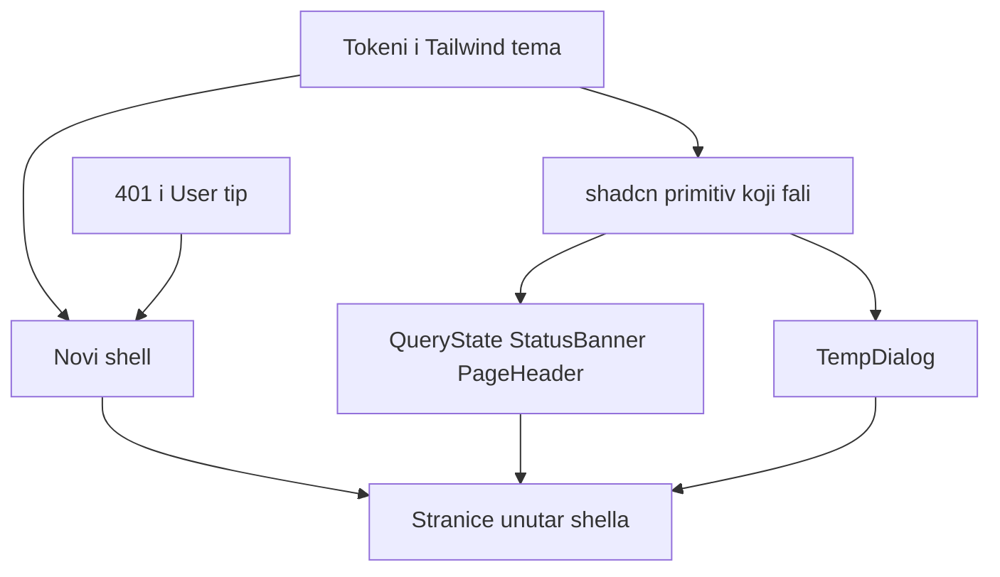

# Međumodulna sinteza

Faza 3. Datum: 2026-11-06. Izvor su `docs/redesign/modules/*.md`, `02-shared-foundations.md`, `decisions.md` i `gate-2.md`. Ažurirano poslije `e7142f1` (vidi `05-audit-of-audit.md`).

## 1. Obrasci

### Kompajl i dva UI sloja

Jedanaest ruta dijeli isti kvar: stranica očekuje lokalni `Button`/`Card`/`Input` (`variant`, `label`, `padding`, `isLoading`), a import je antd ili uopšte ne postoji.

| Obrazac | Nalazi | Status poslije `e7142f1` |
|---|---|---|
| JSX se ne parsira, dva omota u jednom fajlu | SH-01, DA-01 | Zatvoreno (jedno stablo + lokalni importi) |
| Simbol nije importovan | BO-01, HE-01, HE-02, GA-01, RE-01, RE-02, NO-01, HP-01, PR-01 | Zatvoreno za navedene importne greške |
| Import putanja ne postoji | AU-02, DA-06, GR-01 | Zatvoreno |
| Antd komponenta dobija propove lokalnog seta / antd u grafu | GA-03, NO-02, HP-02, PR-02, HE-05, BO-06, SH-02 | **Otvoreno** — UX i Q1 |

Treći set (`frontend/src/components`) i shadcn set (`shared/components/ui`) postoje paralelno. Stranice sada zovu lokalni set. Odluka Q1 i dalje ostavlja samo shadcn; lokalni set umire u I7.

### Greška izgleda kao prazno

Upit padne, stanje ostane `[]`, `{}` ili `null`, a ekran prikaže praznu listu, nule ili praznu formu. Retry nema.

| Modul | Nalaz | Šta korisnik vidi |
|---|---|---|
| Dashboard | DA-04 | Prazan dashboard |
| Boiler | BO-02 | Prazna historija |
| Heating | HE-03 | Prazna lista |
| Gas readings | GR-04 | Tekst bez retry |
| Gas analytics | GA-02 | Nule, error grana je mrtva jer hook vraća `{}` |
| Reports | RE-03 | Prazan izvještaj |
| Notifications | NO-04 | Tekst bez retry |
| Home profile | HP-04 | Forma za create, i na mrežnom padu |
| Profile | PR-06 | Prazna forma, snimanje ne radi |

Isti obrazac na mutacijama: greška ide u `console.error` ili u nedefinisan `message` (NO-03, GR-02). Login je poseban: 401 radi puni reload i briše poruku (AU-01).

Backend za historiju kotla i događaje grijanja na pad vraća HTTP 200 i `[]`. Taj slučaj ostaje prazan ekran. `isError` pokriva mrežu i status koji nije 2xx. To ne mijenja API.

### Tekst

`t()` postoji za auth, gas, notifikacije, preporuke i home profile. Shell, dashboard, boiler, heating, reports, profile i veći dio notifikacija i dalje imaju literal (SH-05, DA-09, BO-08, HE-06, GA-07, RE-05, NO-06, HP-08, PR-08). Obavezna poruka home profila je fiksni bosanski sufiks.

### Dijalog i overlay

Temperaturni dijalog (dashboard i boiler), fioka notifikacija, potvrda brisanja (`window.confirm`) i mobilni drawer nisu pravi dijalog: nema Escape, trapa fokusa ili semantičkog `dialog` (DA-10, BO-04, GR-06, SH-09). `GasForm` to već ima i ostaje uzor, ne novi izum.

`z-fixed` i `z-popover` nisu u Tailwind temi (SH-10). Više stranica ima `id="content"`. Skip link traži `main-content` (SH-04).

### Podaci

Dva načina dohvata:

1. React Query i `lib/queryKeys.ts`: dashboard, boiler, heating, gas, reports, notifikacije.
2. Ručni `useEffect`: home profile i profile. Oba poslije snimanja ne osvježavaju dijeljeni keš (HP-07, PR-07).

Dijeljeni ključevi koji moraju ostati jedan izvor:

| Ključ | Ko piše | Ko čita |
|---|---|---|
| `notifications` | dashboard fioka i notifications stranica | oba |
| gas readings / `gasAnalysisRoot` | forma, kartica, upload | readings i analytics |
| `homeProfile` | dashboard | home profile stranica danas ne invalidira |

Dva ugovora događaja grijanja se ne spajaju. Dashboard status je niz `{ deviceId, isHeatingNow }`. Hook čita polje sa niza (DA-02).

`RecommendationBreakdown` dijele heating, dashboard i reports. Jedan nedostajući import ruši sva tri (HE-02).

## 2. Zajedničke komponente

shadcn danas ima `Button`, `Card`, `Input`, `Label`. Ostalo iz tabele ne postoji. Dodavanje ide kao shadcn primitiv, ne kao treći ručni set. Radix u locku je samo `@radix-ui/react-slot`. Dialog, sheet, select i table povlače nove pakete. To je opravdanje za Fazu 4, ne nova zavisnost u ovoj fazi.

| Kandidat | Zašto | Ko ga koristi | Ne raditi |
|---|---|---|---|
| `PageHeader` | Naslov, opis, jedna akcija. Danas je svaka stranica svoj `h1` | svih devet zaštićenih ruta | Različite veličine naslova |
| `QueryState` | Loading skeleton, error sa retry, empty sa porukom i akcijom | svi upiti iz odjeljka 1 | Spinner preko cijele stranice |
| `StatCard` | KPI. Lokalni već postoji i koriste ga dashboard i gas analytics | DA, GA | Novi vizuelni KPI po stranici |
| `DataTable` | Historija, događaji, preporuke, očitanja | BO, HE, DA, RE, GR | Jedna tabela za dva ugovora grijanja |
| `FilterBar` | Period. Dashboard ima dva datuma, analitika ima režime | DA-05, GA-03 | Jedan widget koji mijenja pravila referentnog režima |
| `TempDialog` | Isti PATCH temperature na dashboardu i boileru | DA-03, BO-03, BO-04, BO-05 | Dva dijaloga, clamp 46 u korisničkom unosu |
| `ConfirmDialog` | Brisanje očitanja | GR-06 | `window.confirm` |
| `StatusBanner` | Uspjeh i greška mutacije, `role="status"` / `role="alert"` | gas, profile, home profile, notifikacije | `message` iz antd-a |
| Shell | Novi layout, `NavLink`, drawer ispod 1024px, jedan `main-content` | SH-01 … SH-10 | Krpljenje `MainLayout.tsx` |

`Announcer` postoji i nije montiran (SH-07). Ne graditi drugi live-region dok se ne odluči da li `StatusBanner` dovoljan.

## 3. Sistemski problemi

Nisu vlasništvo jednog modula:

1. **Tema.** Tri palete: antd hex u `ThemeContext`, `theme-color` u `index.html`, `tokens.css` koji se ne učitava (SH-08). Tailwind `extend.colors` nema `brand`, `surface`, `error`. `index.css` definiše `--border` dvaput. Fokus koristi `rgb(var(--brand))` dok `--brand` nije postavljen. Q2 vrijednosti postaju CSS varijable. Hex u komponentama ostaje zabranjen. Ključ `boiler.theme` i inline skripta protiv FOUC ostaju.
2. **Ant Design u prvom grafu.** `ThemeContext`, `ProtectedRoute` `Spin`, ikone u shellu, `InputNumber`, grafovi `@ant-design/plots` (SH-02, BO-06, DA-09). Uklanja se tek kad stranica koja ga zove bude zamijenjena. `ConfigProvider` se ne gasi prije toga.
3. **Auth tip.** `User` nema `role`, laže `id` kao string i odbacuje `prefersDarkMode` (AU-03, SH-06, SH-11). Shell ne može prikazati ulogu dok se tip ne proširi. Meni i dalje pokazuje devet ruta svim ulogama.
4. **401 interceptor.** Svaki 401 osim refresh toka radi `clearToken` i `location.href = '/login'` (AU-01). Login pad upada u to. Ispravka je u `api.ts`, prije novog login ekrana.
5. **i18n.** Jedan katalog `locales/config.ts`. Nema drugog sistema. Novi string ide u BS i EN.
6. **Redis.** Nema dashboard ključeva. Weather cache je Postgres. Web keš ostaje React Query.
7. **Pristupačnost.** Jedan `main`, labele preko `htmlFor`, dijalog sa trapom, fokus vidljiv. `id="content"` se uklanja sa stranica kad shell ima `main-content`.

## 4. Matrica modul × problem

`x` znači da modul ima taj problem u svom dokumentu. Prazno znači da nije zabilježen.

| Modul | Parse / import | Antd ili tuđi prop | Error = prazno | Literal van `t()` | Dijalog / fokus | Dijeljeni keš |
|---|---|---|---|---|---|---|
| Shell | zatvoreno | x | | x | x | |
| Auth | zatvoreno | | x (401 reload) | djelimično ima `t()` | | |
| Dashboard | zatvoreno | x | x | x | x | x (temp, notifikacije) |
| Boiler | zatvoreno | x | x | x | x | x (temp) |
| Heating | zatvoreno | x | x | x | | |
| Gas readings | zatvoreno | | x | ima `t()` | x | x |
| Gas analytics | zatvoreno | x | x | x | | x |
| Reports | zatvoreno | | x | x | | breakdown |
| Notifications | zatvoreno | x | x | x | x | x |
| Home profile | zatvoreno | x | x | x | | x |
| Profile | zatvoreno | x | x | x | | |

## 5. Zavisnosti i redoslijed

Redoslijed nije plan Faze 4. Ovo su zavisnosti bez kojih modul nema šta da importuje.

1. **Tokeni.** Bez njih svaka nova komponenta ili ponovo uvodi hex ili koristi klasu koje nema u temi (`brand`, `z-fixed`).
2. **`api.ts` 401 i tip `User`.** Login i shell ovise o tome. Nije vizuelni posao.
3. **Shell iznova.** Fajl se parsira, ali je i dalje polovičan (antd ikone, drawer a11y, skip/`main-content`). Q3: rewrite, ne krpanje antd Layout-a.
4. **Primitivi koji fale:** dialog/sheet, select, checkbox, table, toast ili banner. Button/Card/Input/Label već postoje i treba ih uskladiti sa tokenima, ne pisati paralelno.
5. **`QueryState`, `PageHeader`, `StatCard`, `StatusBanner`.** Stranice ih zovu umjesto da svaka ponovi prazan `catch`.
6. **`TempDialog` prije dashboarda i boilera.** Jedan dijalog, oba pozivaoca invalidiraju oba ključa.
7. **`RecommendationBreakdown` prije heatinga, dashboarda i reportsa.** Inače tri ekrana dijele isti pad.
8. **Stranice.** Poslije temelja, red po tome koliko drugih lome i koliko su operativne:
   - Auth login, jer je ulaz i drži AU-01 (401 reload).
   - Dashboard, jer drži temperaturu, health, notifikacije, preporuku i plots.
   - Boiler, isti dijalog.
   - Heating, pa reports, jer dijele breakdown.
   - Gas readings, pa analytics. Readings drži formu, karticu i download. Analytics čita isti keš i ne smije računati cijenu.
   - Notifications, isti ključ kao fioka na dashboardu.
   - Home profile, pa profile. Oba su forme. Home profile invalidira dashboard ključ. Profile šalje uzak PUT.

`@ant-design/plots` otpada sa dashboard grafikonom, ne prije. Prazan dashboard bez grafa nije međukorak koji ostaje.

## 6. Šta ostaje lokalno

Ovo se ne izvlači u zajednički helper koji bi promijenio broj:

- Unos temperature 48–55. Preporuka smije predložiti 46. To nije isti clamp.
- Health score samo sa `GET /api/dashboard/health`.
- Anomalija na kartici: zadnjih 5 događaja prvog doma.
- Heating lista: `timestampStart`, najviše 100. Dashboard: `startedAt`, limit 500.
- Potrošnja plina: novije stanje minus tekuće. Ime propa smije postati `newerReading`.
- Referentna analiza bez `from`/`to`.
- Breakdown je serverski snapshot. `confidenceScore * 100` ostaje dok DTO ne kaže drugačije (RE-06).
- Home profile granice su one u `validate`, ne Zod.
- PUT profila: `name`, `username`, `homeLocation`, `timezone`, `locale`, `gasPriceExVat`. Email van tijela.
- Preuzimanje fajla ide kroz `downloadProtectedFile`.
- Devet ruta svim ulogama. Admin test endpoint nije stavka menija.

## 7. Šta ova faza ne zatvara

- Q8 Lighthouse. Nije izmjeren (build više nije blokiran parse-om).
- HTTP status kad home profil ne postoji (HP-04). Create i mrežni pad se razdvajaju u implementaciji tek kad se status pročita, bez novog endpointa.
- Raspon `confidenceScore` (RE-06).
- Da li `prefersDarkMode` sa profila prepisuje `boiler.theme`. SH-11 je nizak. Inicijalizacija ostaje lokalni ključ dok Faza 4 ne kaže drugačije.
