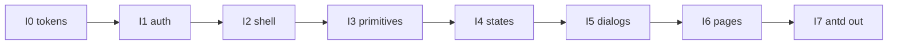

# Plan implementacije (Faza 5)

Datum: 2026-11-06. Pristup: opcija A (`07-decision-record.md`). Pravila: `09-implementation-rules.md`. Dizajn: `06-design-direction.md`.

Poslovna pravila iz `04` §6 se ne mijenjaju. Prisma, API ugovor i auth logika van opsega.

Svaka podfaza: commit → push → `gh run watch` Frontend CI. Stop ako CI crven ili poslovni broj regressira.

---

## I0 — Tokeni i tema

**Cilj:** Jedan izvor boja/razmaka; Tailwind klase `brand`, `surface`, `text-*`, `success`, `error`, z-index rade.

**Fajlovi:** `index.css`, `tailwind.config.js`, `design/tokens.css` (učitati ili obrisati), fontovi po `06`.

**Zavisnosti:** nema.

**Acceptance:** `tsc`, lint, test, build zeleni; light/dark vizuelno na login; nema duplog `--border`; hex samo u token fajlu.

**Testovi:** postojeći FOUC/a11y testovi i dalje prolaze (`boiler.theme`).

**Trud:** M. **Rizik:** vizuelni regres na dark. **Rollback:** revert I0 commit.

---

## I1 — Auth tip i 401

**Cilj:** Login 401 ne radi full reload; `User` ima `id: number`, `role`, `plan?`, `prefersDarkMode?`.

**Fajlovi:** `services/api.ts`, `features/auth/AuthContext.tsx`, `LoginPage.tsx` (prazna polja → `t()` required).

**Zavisnosti:** I0 poželjno (stil), nije strogo.

**Acceptance:** neuspješan login pokazuje poruku; uspješan ide na dashboard; tip `role` dostupan shellu.

**Testovi:** ProtectedRoute suite; dodati test da 401 na `/auth/login` ne radi `location.href` (mock).

**Trud:** S. **Rizik:** refresh tok. **Rollback:** revert I1.

---

## I2 — Shell rewrite

**Cilj:** Novi layout bez antd Layout/Menu; `NavLink`; drawer Sheet ispod lg; `#main-content`; prikaz uloge.

**Fajlovi:** `MainLayout.tsx` (rewrite), SkipLink, Theme toggle, logout.

**Zavisnosti:** I0, I1 (`role`).

**Acceptance:** 9 ruta u meniju svim ulogama; Escape zatvara drawer; skip radi; nema antd Layout.

**Testovi:** smoke navigacije (RTL ili e2e postojeći); tastatura skip.

**Trud:** M. **Rizik:** routing. **Rollback:** revert I2.

---

## I3 — shadcn primitiv

**Cilj:** Dialog, Sheet, Select, Checkbox, Table, Switch (+ lucide-react). Button/Card/Input/Label usklađeni sa I0. Brojčani unos bez antd `InputNumber` omotača.

**Fajlovi:** `shared/components/ui/*`, `package.json` (Radix + lucide).

**Zavisnosti:** I0.

**Acceptance:** nove komponente u story/test a11y; `npm ls` pokazuje dodate pakete samo uz obrazloženje u commit poruci.

**Trud:** M. **Rizik:** bundle size. **Rollback:** revert I3 + `package-lock`.

---

## I4 — Shared stanja

**Cilj:** `PageHeader`, `QueryState`, `StatCard` (shadcn Card), `StatusBanner`.

**Fajlovi:** `shared/components/` (ili dogovoreni folder ≤150 linija po fajlu).

**Zavisnosti:** I3.

**Acceptance:** jedan demo na login ili shell fallback koristi QueryState; dokumentovani props.

**Trud:** S–M. **Rollback:** revert I4.

---

## I5 — TempDialog i ConfirmDialog

**Cilj:** Jedan dijalog temperature (48–55); Confirm umjesto `window.confirm`. Fokus trap kao GasForm.

**Fajlovi:** shared dialogs; potrošači još ne moraju svi migrirati (dashboard/boiler u I6).

**Zavisnosti:** I3, I4.

**Acceptance:** Escape/Tab; invalidacija `boiler` + `dashboard` ključeva dokumentovana.

**Testovi:** karakterizacija granica 48/55 prije spajanja na stranice.

**Trud:** S–M. **Rollback:** revert I5.

---

## I6 — Stranice (redom)

Red: Auth → Dashboard → Boiler → Heating → Reports → Gas readings → Gas analytics → Notifications → Home profile → Profile.

Po stranici (može više commitova unutar I6):

1. Preći na shadcn + PageHeader + QueryState.
2. Ispraviti error≠empty; i18n literale.
3. Sačuvati poslovna pravila `04` §6.
4. Dashboard: SVG bar umjesto plots; `isHeatingNow` sa elemenata niza; kontrolisani datumi; `dashboardQuery.refetch`.
5. Gas: zadržati focus trap forme; `downloadProtectedFile`; formula potrošnje.
6. Home profile: create kad nema profila; razdvojiti mrežni error; granice forme.
7. Profile: PUT samo DTO polja; PDV iz `gasPriceVatRate`.

**Zavisnosti:** I2–I5. Breakdown komponenta prije Heating/Reports/Dashboard dijelova.

**Acceptance po stranici:** tsc/lint/test/build; ruta render; loading/error/empty; bez console error na srećnom putu.

**Trud:** L. **Rollback:** revert stranice commit.

---

## I7 — Ukloniti antd, polish, baseline

**Cilj:** Nema `antd` / `@ant-design/plots` / `@ant-design/icons` u `frontend` produkcijskom grafu. Obrisati mrtav lokalni `components/{Button,Card,…}` ako nema importa. ThemeContext bez ConfigProvider. Lighthouse (Q8) na login + jednoj zaštićenoj ruti ako sesija postoji.

**Acceptance:** `package.json` bez antd deps (ili ostaju dok se ne uklone — cilj nula importa); build; Lighthouse brojevi upisani u `03-baseline.md` ili novi annex; CI zelen.

**Trud:** M. **Rizik:** propušten import. **Rollback:** revert I7 (antd se vraća samo ako mora — izbjegavati).

---

## Van opsega

- `mobile/`
- Prisma / novi endpointi / promjena DTO
- Redis dashboard keš
- Admin-only meni stavke bez `@Roles` endpointa
- Feature flag v2 (opcija B)
